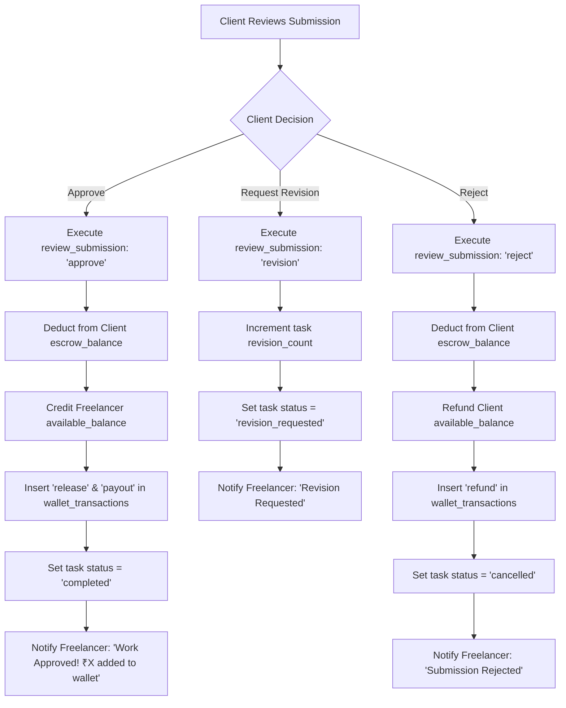

# TaskForge – Architecture & Engineering Master Documentation

> **TaskForge** is an intelligent, milestone-driven freelance marketplace featuring task decomposition, a double-entry escrow ledger, real-time push notifications, dynamic performance-based ratings, and strict role-based access control.

---

## 1. Executive Summary & Core Value Proposition

Traditional freelance platforms suffer from three major friction points:
1. **Scope Ambiguity**: Projects are posted as massive, vague contracts leading to disputes.
2. **Payment Insecurity**: Clients risk paying upfront for incomplete work; freelancers risk working without guaranteed compensation.
3. **Static / Biased Reputation**: Arbitrary 5-star subjective reviews that don't reflect actual delivery track records.

### How TaskForge Solves This
* **Task Decomposition**: Large projects are broken down into discrete, estimable tasks with specific acceptance criteria, deadlines, and rewards.
* **Smart Escrow & Ledger**: Client funds are verified and locked into escrow *prior* to publishing tasks. Escrow release is cryptographically and transactionally tied to milestone deliverables review.
* **Algorithmic Dynamic Rating**: Freelancer ratings are mathematically derived from their milestone acceptance vs. rejection track record: `Rating = 5.0 × (Accepted / (Accepted + Rejected))`.
* **Zero-Poll Real-Time Reactivity**: PostgreSQL event triggers emit real-time WebSocket notifications directly to client and freelancer interfaces on state transitions.

---

## 2. Complete Technology Stack

| Layer | Technologies | Role & Architectural Reasoning |
|---|---|---|
| **Frontend Framework** | **Next.js 16 (App Router)** | Server Components (RSC) for zero-client-bundle data fetching, Server Actions for transactional mutations, Dynamic Routing for nested project/task layouts. |
| **Language & Typings** | **TypeScript 5+** | End-to-end static typing across database schemas, RPC contracts, UI props, and server actions. Prevents runtime property mismatch errors. |
| **Styling & Design System** | **Tailwind CSS v4 + PostCSS** | Modern CSS variable theme tokens (`--background`, `--card`, `--primary`, `--border`), semantic color scales, custom scrollbars, and fluid dark/light transitions. |
| **Theme Management** | **`next-themes`** | Persistent class-based (`.dark`) theme switching with zero hydration layout shift via custom inline script suppression. |
| **Icons & UI Feedback** | **Lucide React + Sonner** | Consistent SVG iconography + rich toast notifications for asynchronous user actions. |
| **Database & Identity** | **Supabase (PostgreSQL 15+)** | Cloud-native relational database, strict Row Level Security (RLS), custom PL/pgSQL stored procedures (RPCs), and ACID transaction guarantees. |
| **Authentication & IAM** | **Supabase Auth (GoTrue)** | Secure JWT handling, cookie-based sessions across Next.js server components via `@supabase/ssr`, role metadata enforcement (`client` vs `freelancer`). |
| **Object Storage** | **Supabase Storage** | Private S3-compatible bucket for encrypted PDF resume uploads with public URL resolution and strict 5MB size validation. |
| **Realtime Pub/Sub** | **PostgreSQL WAL + Supabase Realtime** | WebSocket subscription to database changes via `supabase_realtime` publication, driving real-time in-app notification badges and dropdown feeds. |
| **AI Decomposition** | **Anthropic Claude 3.5 Sonnet + Zod** | Server-side milestone generation (`@anthropic-ai/sdk`), Zod schema validation, and independent mathematical proportional budget clamping. |
| **Deployment & Hosting** | **Vercel Edge Network** | CI/CD automated pipeline from Git, serverless function execution, edge caching, and automated HTTPS. |

---

## 3. Database Architecture & Schema Deep-Dive

The database is built on **PostgreSQL** with foreign key constraints, indexes on high-frequency query paths, and automated timestamp updates.

```
                          ┌──────────────────────────┐
                          │   auth.users (Supabase)  │
                          └─────────────┬────────────┘
                                        │ 1:1
                                        ▼
                          ┌──────────────────────────┐
                          │     public.profiles      │
                          ├──────────────────────────┤
                          │ id (PK, UUID)            │
                          │ full_name: TEXT          │
                          │ role: 'client'|'freelancer'
                          │ skills: TEXT[]           │
                          │ resume_url: TEXT         │
                          │ rating: NUMERIC          │
                          └──────┬────────────┬──────┘
                                 │            │
            Client (1:N)         │            │ Freelancer (1:N)
     ┌───────────────────────────┘            └─────────────────────────┐
     ▼                                                                  ▼
┌────────────────────────┐                                   ┌────────────────────────┐
│    public.projects     │                                   │  public.applications   │
├────────────────────────┤                                   ├────────────────────────┤
│ id (PK, UUID)          │                                   │ id (PK, UUID)          │
│ client_id (FK->profile)│                                   │ task_id (FK->tasks)    │
│ title: TEXT            │                                   │ freelancer_id (FK)     │
│ description: TEXT      │                                   │ status: pending/acc/rej│
│ total_budget: NUMERIC  │                                   │ message: TEXT          │
│ status: draft/published│                                   └────────────────────────┘
└───────────┬────────────┘                                                ▲
            │ 1:N                                                         │
            ▼                                                             │
┌─────────────────────────────────┐                                       │
│          public.tasks           │                                       │
├─────────────────────────────────┤                                       │
│ id (PK, UUID)                   │                                       │
│ project_id (FK->projects)       │                                       │
│ title: TEXT                     │                                       │
│ description: TEXT               │                                       │
│ reward_amount: NUMERIC          │───────────────────────────────────────┘
│ deadline: TIMESTAMPTZ           │ 1:N
│ complexity: INT (1-5)           │
│ estimated_hours: INT            │
│ skills_required: TEXT[]         │
│ status: draft/open/assigned/    │
│         in_progress/submitted/  │
│         revision_requested/     │
│         completed/cancelled     │
│ assigned_to (FK->profiles)      │
│ revision_count: INT             │
│ max_revisions: INT              │
└───────────┬─────────────────────┘
            │ 1:N
            ▼
┌─────────────────────────────────┐           ┌─────────────────────────────────┐
│       public.submissions        │ 1:1       │         public.reviews          │
├─────────────────────────────────┼──────────►├─────────────────────────────────┤
│ id (PK, UUID)                   │           │ id (PK, UUID)                   │
│ task_id (FK->tasks)             │           │ submission_id (FK->submissions) │
│ freelancer_id (FK->profiles)    │           │ reviewer_id (FK->profiles)      │
│ version: INT                    │           │ decision: approve/revision/rej  │
│ links: TEXT[]                   │           │ feedback: TEXT                  │
│ notes: TEXT                     │           │ created_at: TIMESTAMPTZ         │
│ created_at: TIMESTAMPTZ         │           └─────────────────────────────────┘
└─────────────────────────────────┘

═══════════════════════ FINANCIAL & NOTIFICATION SUBSYSTEMS ═══════════════════════

┌─────────────────────────────────┐           ┌─────────────────────────────────┐
│     public.wallet_balances      │           │    public.wallet_transactions   │
├─────────────────────────────────┤           ├─────────────────────────────────┤
│ user_id (PK, FK->profiles)      │           │ id (PK, UUID)                   │
│ available_balance: NUMERIC      │           │ user_id (FK->profiles)          │
│ escrow_balance: NUMERIC         │           │ type: deposit/escrow_hold/      │
│ updated_at: TIMESTAMPTZ         │           │       release/refund/payout     │
└─────────────────────────────────┘           │ amount: NUMERIC                 │
                                              │ task_id (FK->tasks, nullable)   │
                                              │ created_at: TIMESTAMPTZ         │
                                              └─────────────────────────────────┘

┌─────────────────────────────────┐
│      public.notifications       │
├─────────────────────────────────┤
│ id (PK, UUID)                   │
│ user_id (FK->profiles)          │
│ title: TEXT                     │
│ message: TEXT                   │
│ link: TEXT                      │
│ type: 'info'|'success'|'warning'│
│ is_read: BOOLEAN                │
│ created_at: TIMESTAMPTZ         │
└─────────────────────────────────┘
```

---

## 4. End-to-End Business Logic & Workflows

### 4.1 Project Creation & AI Decomposition (Human-in-the-Loop)
1. Client logs in → role verified as `'client'` via session and database profiles.
2. Client enters project title, description, and target total budget (`/projects/new`).
3. Upon clicking **"Create & Decompose with AI"**:
   - The server creates the project in `'draft'` status.
   - The server-side AI engine (`lib/ai/decompose.ts`) calls Claude 3.5 Sonnet to decompose the scope into 3 to 6 structured milestones.
   - Each milestone is verified via Zod (`MilestoneTaskSchema`) and mathematically clamped so `sum(rewards) <= total_budget`.
   - The milestones are bulk-inserted with `status = 'draft'`.
   - If AI generation encounters an API error, the client is redirected to the review page with a clear notice and a **"Retry AI Decomposition"** action.
4. **Human-in-the-Loop Review Interface (`/projects/[id]`)**:
   - The client reviews the generated milestones, skills, and criteria.
   - The client can **Edit** any milestone via `/projects/[id]/tasks/[taskId]/edit`, modify rewards/hours, or **Delete** unwanted milestones.
   - The client may optionally add a custom milestone before approval.
   - The client clicks **"Approve & Lock Escrow"** to finalize the project.

### 4.2 Escrow Locking & Publishing (`publish_project` RPC)
* Unlike conventional platforms where projects go live without collateral, TaskForge enforces escrow-first publishing:
* When client clicks **"Publish Project"**:
  1. Calls stored procedure `publish_project(p_project_id)`.
  2. The procedure checks the client's `wallet_balances.available_balance`.
  3. If balance is insufficient, transaction rolls back with `Insufficient funds in wallet`.
  4. If balance is sufficient:
     - Deducts total task reward sum from `available_balance`.
     - Adds total sum to `escrow_balance`.
     - Records an immutable `escrow_hold` record in `wallet_transactions`.
     - Flips project status to `'published'` and task statuses to `'open'`.
     - All tasks are atomically broadcasted to the **Freelancer Marketplace**.

### 4.3 Marketplace Discovery & Application Pipeline
1. Freelancers browse `/marketplace` with filter chips matching their profile skills.
2. Freelancer submits application with message/pitch (`apply_for_task`).
3. Client receives an instant real-time notification: *"New Applicant on Task X"*.
4. Client navigates to `/projects/[id]/tasks/[taskId]/applicants`:
   - Sees each applicant's **live dynamic rating**, match tags, and clickable **PDF resume link**.
   - Clicks **"Select this Freelancer"** (`accept_application` RPC).
   - In a single ACID transaction:
     - Chosen application status becomes `'accepted'`.
     - All competing pending applications are marked `'rejected'`.
     - Task status flips to `'assigned'`, setting `assigned_to = freelancer_id`.
     - Triggers automated push notification to the chosen freelancer.

### 4.4 Task Execution & Work Submission
1. Freelancer sees the task on their `/my-tasks` dashboard.
2. Freelancer clicks **"Start Work"** (`start_task` RPC) → status updates to `'in_progress'`.
3. When ready, the submission form renders directly in the card:
   - Validates live URLs (GitHub repos, Figma boards, Google Drive, Vercel deployments).
   - Collects submission notes and release instructions.
   - Calls `submit_work(p_task_id, p_links, p_notes)` RPC.
   - Creates a versioned row in `submissions` (`version = current + 1`).
   - Task status transitions to `'submitted'`.
   - Client is notified: *"Work Submitted for Review 🚀"*.

### 4.5 Client Review, Milestone Payout & Refund
The client reviews deliverables at `/projects/[id]/tasks/[taskId]/review` (`review_submission` RPC):



---

## 5. Algorithmic Rating Engine (`lib/rating.ts`)

Instead of subjective star reviews, TaskForge implements an objective, delivery-backed rating system.

### The Mathematical Formula

$$\text{Rating} = 5.0 \times \left( \frac{\text{Accepted Milestones}}{\text{Accepted Milestones} + \text{Rejected Milestones}} \right)$$

* **Edge Case (Zero decided milestones)**: If $\text{Accepted} + \text{Rejected} = 0$, rating defaults to **5.0** and is explicitly tagged as **"New Talent"** (`isNew: true`), preventing cold-start discrimination against new freelancers.
* **Granular Aggregation Query (`getFreelancerStats`)**:
  - Pulls all tasks where `assigned_to = freelancer_id`.
  - Pulls all submissions and cross-references client reviews (`decision = 'approve'` vs `decision = 'reject'`).
  - Computes:
    - $\text{Accepted} = \max(\text{completedTasks}, \text{approvedReviews})$
    - $\text{Rejected} = \text{rejectedReviews count}$
    - $\text{In-Review} = \text{revision reviews} + \text{currently active review tasks}$
    - $\text{Acceptance Percentage} = \text{round}\left(\frac{\text{Accepted}}{\text{Accepted} + \text{Rejected}} \times 100\right)$

---

## 6. Real-Time Push Notification Subsystem

TaskForge eliminates polling by combining PostgreSQL database triggers with Supabase Realtime WebSocket channels.

### Architecture
```
[User Action: Submit Work]
           │
           ▼
[tasks Table Updated to 'submitted']
           │
           ▼
[Postgres Trigger: trigger_notify_on_task_state_change]
           │
           ▼
[Inserts Row into public.notifications]
           │
           ▼ (WAL Log Stream)
[Supabase Realtime Engine (Elixir/Phoenix WebSockets)]
           │
           ▼
[Client Browser: useRealtimeNotifications Hook]
           │
           ├─► Plays sound / Toast notification (Sonner)
           ├─► Increments unread count badge in NotificationBell
           └─► Appends item to realtime drop-down feed
```

---

## 7. Security, Authorization & RLS Model

Every table in TaskForge is secured via **Row-Level Security (RLS)** in PostgreSQL:

1. **Role Enforcement**:
   - Roles (`client` vs `freelancer`) are immutable once chosen at registration.
   - Dashboard strictly parses `profile.role` and `user.user_metadata.role`.
   - Client routes (`/projects/new`, `/projects/[id]/tasks/[taskId]/review`) redirect non-clients immediately.
   - Freelancer routes (`/my-tasks`, `/marketplace`) enforce freelancer credentials.
2. **Profile Confidentiality**:
   - Clients **do not have** public ratings, public profiles, or resume upload endpoints.
   - Only freelancers have a profile page (`/freelancers/[id]`). Any attempt to access a client ID at `/freelancers/[id]` throws an immediate `404 Not Found`.
3. **Storage Security**:
   - Resumes bucket restricted to `application/pdf` with strict 5MB file size limits.
   - Storage uploads use sanitized file paths (`${userId}.pdf`) with upsert permissions scoped to `auth.uid() = userId`.

---

## 8. Panel Presentation & Cross-Questioning Guide (Defense Prep)

Be prepared to answer these technical questions during your project defense:

### Q1: Why did you choose Supabase over a standalone Node.js / Express backend?
> **Answer**: Supabase gives us an enterprise-grade PostgreSQL instance with built-in connection pooling, row-level security, instant WebSocket real-time subscriptions, and ACID-compliant transaction blocks (via PL/pgSQL RPCs). By combining Next.js 16 Server Components and Server Actions with Supabase, we achieve a modern serverless architecture with zero server maintenance overhead, reduced network hops, and bank-grade data isolation directly at the database engine level.

### Q2: How does TaskForge prevent race conditions in payment release?
> **Answer**: All wallet and escrow operations are handled inside PostgreSQL stored procedures (`publish_project`, `review_submission`) executed with `SECURITY DEFINER` within atomic transactions (`BEGIN ... COMMIT`). If any sub-operation fails (e.g. updating task status or crediting the freelancer's wallet), the entire transaction rolls back automatically, preventing partial writes or double-spending.

### Q3: What prevents a client from accepting work and taking their money back?
> **Answer**: The escrow balance is locked at project publishing time and removed from the client's available balance. The client cannot withdraw or refund escrowed funds unilaterally while a task is in progress. Funds can only be released upon approved deliverables or refunded if the work violates stated acceptance criteria and is rejected through the recorded review mechanism.

### Q4: Why is the freelancer rating calculated dynamically instead of being stored in a column?
> **Answer**: Storing a static rating creates state-synchronization bugs and audit vulnerabilities. If an admin cancels a task or a review is revised, a static column can become inconsistent. By deriving the score on-the-fly using `computeFreelancerRating`, the rating is a 100% accurate, tamper-proof reflection of all recorded milestone decisions in the audit ledger.

### Q5: How is client vs freelancer role segregation enforced?
> **Answer**: Segregation is enforced at three distinct layers:
> 1. **Authentication layer**: Auth metadata stores the user's role on sign-up.
> 2. **Application routing layer**: Server components check `profile.role` before rendering pages (`redirect("/dashboard")` on permission violation).
> 3. **Database RLS layer**: PostgreSQL policies evaluate `auth.uid()` against `client_id` or `freelancer_id` on each table operation.

---

*TaskForge Documentation compiled on 2026-10-27.*
